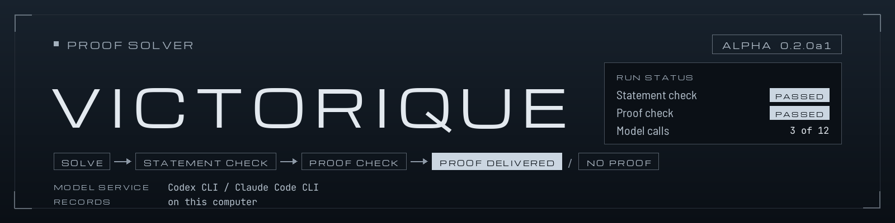
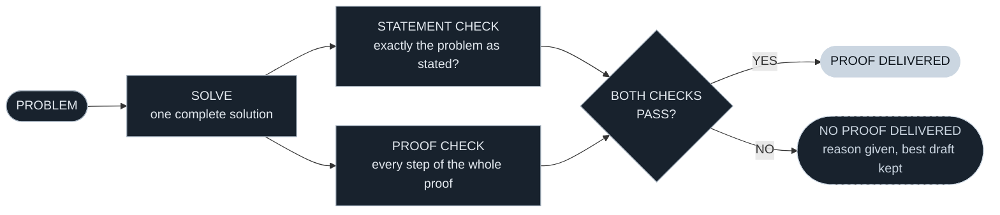
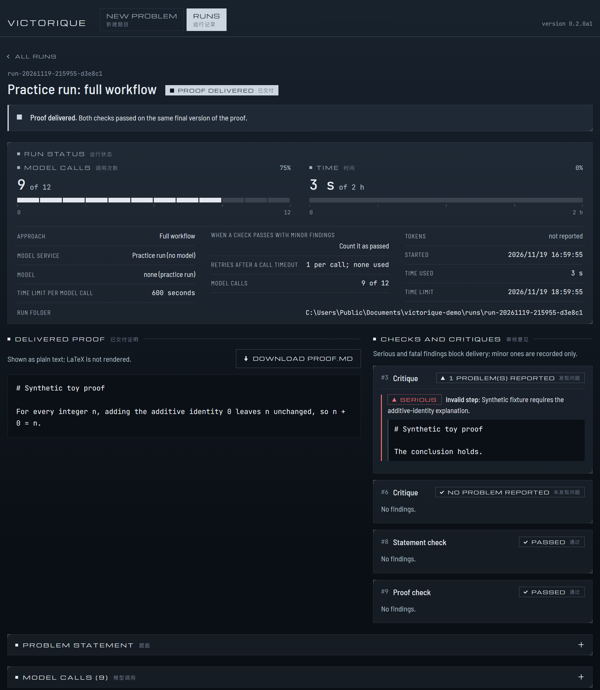
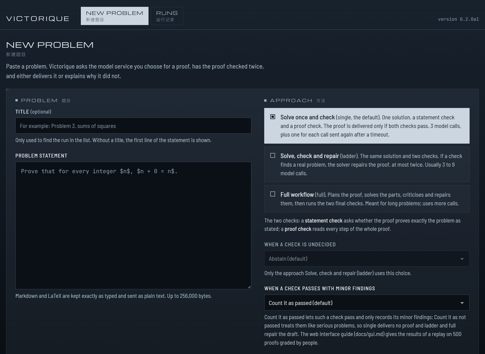
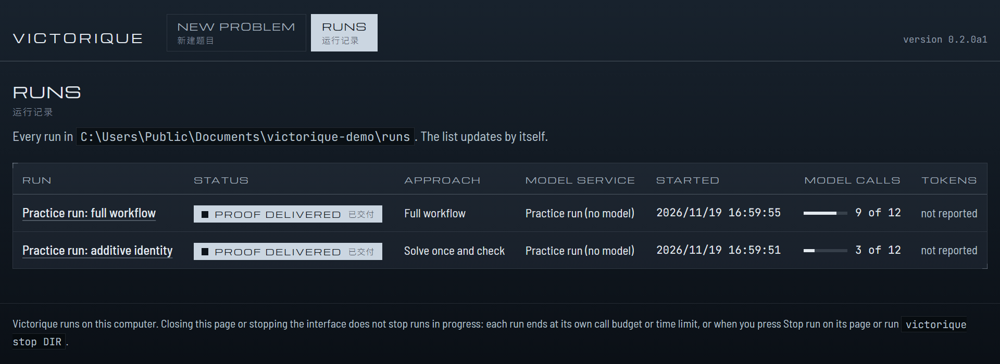

<p align="center">
  
</p>

<p align="center">
  <a href="CHANGELOG.md"></a>
  
  <a href="LICENSE"></a>
  
  <a href="#known-limitations"></a>
</p>

<p align="center"><b>English</b> | <a href="docs/quickstart.zh.md">中文入门</a></p>

Victorique asks a language model to prove a mathematics problem. Two more
model calls check the proof. You get the proof only if both checks pass;
otherwise the run stops and gives the reason. Victorique runs on your computer
and keeps a complete record of every run there. It calls the model through a
command-line tool that you install and log in to yourself: Codex CLI or Claude
Code CLI. A page in your browser lets you start runs and read the results
without typing commands.

> [!NOTE]
> Version 0.2.0a1 is an Alpha release. It was tested on Windows only; see
> [Known limitations](#known-limitations).

## Compared with one direct model call

On benchmark problems with a frontier model, Victorique did not solve more
problems than one direct call to the same model. In the November 2026 study,
GPT-6 Astra (through the Codex CLI, at its highest reasoning effort) worked on
72 olympiad-level proof problems, four times each, 288 problem rounds in all:

- one direct call, whose proof is delivered without any check, solved 276;
- `full`, Victorique's longest workflow (plan, solve in parts, criticise,
  repair, then the two checks), solved 277;
- `single`, the default (the same one call plus the two checks), solved 271.
  Of the five first drafts scored 7/7 that it did not deliver, the checks
  rejected three, all on problem NEM-G1: the drafts disproved the stated claim
  with a counterexample, and the checks agreed that the counterexample is
  valid, but a check passes only a proof of the statement as given. The old
  precheck for unfinished text stopped the other two; its marker rule was
  corrected in 0.1.0b2, and `single` in this release does not run it.

A problem round counts as solved when the delivered proof was scored 7/7 by a
grader from the solver's own model family, so these numbers are provisional.
The direct call is the first draft that `single` checks, scored without the
checks; it was not run as a separate policy. Open problems were not measured.

Compared with a direct call, a Victorique run adds: the two checks before a
proof is delivered; a stop with the reason when a check does not pass (an
abstention); a complete local record of every call; limits on calls and time.
The checks are model calls themselves and make mistakes; their measured error
rates are under [Known limitations](#known-limitations).

The [study results](docs/study.md) give the numbers of every approach, with
intervals, tokens and time.

## How a run works

By default Victorique asks the model for one complete solution. Two separate
calls then check it, each in a fresh context and on the same version of the
proof: the *statement check* asks whether the proof proves exactly the problem
as stated, and the *proof check* reads every step of the whole proof.



This is the default approach, `single` (*Solve once and check* on the web
page). It makes 3 model calls, plus one for each call sent again after a
timeout. When a check does not pass, Victorique says which check it was and
what it found, and keeps the draft in `proof.md`, marked as not delivered.

## Screenshots

<p align="center">
  
  <br>
  <sub><b>RUN PAGE</b>. A practice run with the full workflow; proof delivered. Practice runs call no model.</sub>
</p>

<table>
  <tr>
    <td width="50%" valign="top" align="center">
      
      <br>
      <sub><b>NEW PROBLEM</b>. The form; the default approach is <i>Solve once and check</i>.</sub>
    </td>
    <td width="50%" valign="top" align="center">
      
      <br>
      <sub><b>RUNS</b>. Two practice runs; no model was called.</sub>
    </td>
  </tr>
</table>

## What Victorique does

| FUNCTION | DESCRIPTION |
| --- | --- |
| **SOLVE** | One complete solution from the model; default approach `single` ([How a run works](#how-a-run-works)). |
| **STATEMENT CHECK** | A separate model call: does the proof prove exactly the problem as stated? |
| **PROOF CHECK** | A separate model call reads every step of the whole proof. |
| **DELIVERY** | Proof delivered only if both checks pass. Otherwise no proof; the run names the check that did not pass and what it found, and keeps the best draft, marked as not delivered. |
| **RECORDS** | One folder per run: the problem, the delivered proof or the best draft (`proof.md`), a summary (`summary.json`), one line per model call with its times and tokens (`calls.jsonl`), the full exchange with the model service. |
| **LIMITS** | Defaults: at most 12 model calls, 2 hours for the whole run, 600 seconds for each model call. The default run makes 3 model calls, plus one for each call sent again after a timeout. |
| **STOP / RESUME** | A run can be stopped at any time; it then sends no new call and keeps its best draft. A run whose process ended early, for example when the computer restarted, can be resumed within its original limits. |
| **INTERFACE** | `victorique gui` opens a page in your browser: paste a problem, follow the run, read the result. The page and its fonts come from your computer. |
| **OTHER APPROACHES** | `ladder` repairs the proof at most twice after a failed check. `full` plans, solves in parts, criticises and repairs; for long problems ([Approaches](docs/usage.md#approaches)). |

## Install

You need Python 3.11 or newer (this release was tested with Python 3.11) from
[python.org](https://www.python.org/downloads/). The first command below
creates a separate Python environment, `victorique-venv` in your user folder,
so that your other Python installations stay unchanged; with a newer Python,
write its version, for example `py -3.12`.

### From the repository

This needs Git. In Windows PowerShell:

```powershell
py -3.11 -m venv "$HOME\victorique-venv"
& "$HOME\victorique-venv\Scripts\python.exe" -m pip install "git+https://github.com/Yyuzrah/Solver_Victorique.git@v0.2.0a1"
& "$HOME\victorique-venv\Scripts\victorique.exe" --version
```

The last command prints `0.2.0a1`. A downloaded copy of the repository folder
can be installed the same way, with its path in place of the `git+` address.

### From the wheel file

Once the release is published, the
[release page](https://github.com/Yyuzrah/Solver_Victorique/releases) offers
the file `victorique-0.2.0a1-py3-none-any.whl`. Download it and replace the
second command above with:

```powershell
& "$HOME\victorique-venv\Scripts\python.exe" -m pip install "$HOME\Downloads\victorique-0.2.0a1-py3-none-any.whl"
```

On macOS or Linux, which this release was not tested on, the commands are:

```sh
python3 -m venv ~/victorique-venv
~/victorique-venv/bin/python -m pip install ~/Downloads/victorique-0.2.0a1-py3-none-any.whl
~/victorique-venv/bin/victorique --version
```

With the `git+` address in place of the wheel file, the second command installs
from the repository.

### With your coding agent

If you use a coding agent such as Codex or Claude Code, you can give it this
instruction instead:

> Install Victorique 0.2.0a1 for me. Use Python 3.11 or newer and create a new
> virtual environment named `victorique-venv` in my home folder; leave my other
> Python environments unchanged. Install the wheel file
> `victorique-0.2.0a1-py3-none-any.whl` from the release page at
> https://github.com/Yyuzrah/Solver_Victorique/releases (or the file I give
> you) with that environment's pip. Then, in a new empty folder, run that
> environment's `victorique --version` and check that it prints 0.2.0a1. Do a
> practice run that calls no model: create `problem.md` containing
> `Prove that n + 0 = n for every integer n.` and run
> `victorique solve problem.md --transport fake --out practice`. Report the
> outcome and the number of model calls from `practice/summary.json` (expected:
> outcome complete, 3 calls). Do not log in to any service, do not open login
> or key files, and do not run a solve with a real model. Finally tell me the
> full path of the `victorique` command and the command that starts the web
> interface: `victorique gui` with that full path, started from the folder
> where my runs should be kept. Detailed steps are in INSTALL.md in the
> repository.

[INSTALL.md](INSTALL.md) has the step-by-step version of this instruction.

## Quick start

1. **Start the web interface** in the folder where your runs should be stored:

   ```powershell
   New-Item -ItemType Directory -Force "$HOME\victorique-work" | Out-Null
   Set-Location "$HOME\victorique-work"
   & "$HOME\victorique-venv\Scripts\victorique.exe" gui
   ```

   It opens `http://127.0.0.1:8765/`, or the next free port, in your browser.
   Keep the window open while you use the page; Ctrl+C stops the interface, and
   runs in progress keep going.
2. **Practice run.** On *New problem*, paste
   `Prove that n + 0 = n for every integer n.`, choose
   *Practice run (no model is called)* and press *Start*. It makes 3 calls to a
   built-in stand-in with fixed example answers and ends with *Proof delivered*.
3. **A real run.** Choose *Codex CLI* or *Claude Code CLI* as the model service
   (see [Model services](#model-services)), keep *Solve once and check* and the
   default limits, paste your problem and press *Start*.
4. **Stop and resume.** *Stop run* on the run page stops a run, and a run whose
   process ended early has a *Resume* button. From a terminal,
   `victorique stop DIR` and `victorique resume DIR` do the same.

Runs are stored in `runs` inside the folder where you started `victorique gui`.
The [usage guide](docs/usage.md) describes the run page, the run files and the
command line; the [web interface guide](docs/gui.md) describes every field and
status.

## Model services

Victorique calls a model only through a command-line tool that you install and
log in to yourself:

- **Codex CLI** (OpenAI models). Install the native Codex CLI with the
  [official guide](https://learn.chatgpt.com/docs/codex/cli) and log in with
  `codex login`. Codex Desktop alone does not always provide a `codex` command;
  `VICTORIQUE_CODEX_BINARY` can name the executable
  ([INSTALL.md](INSTALL.md#codex-cli-availability)).
- **Claude Code CLI** (Anthropic models). Install Claude Code from Anthropic's
  documentation at code.claude.com and log it in with an Anthropic Console
  account: run `claude`, type `/login` and choose the Anthropic Console account
  (API usage billing). Anthropic's
  [legal and compliance page](https://code.claude.com/docs/en/legal-and-compliance)
  (checked 2026-11-19) keeps the Claude.ai subscription login (Free, Pro, Max,
  Ultra) for ordinary use of Anthropic's own apps such as Claude Code, asks
  developers who build products to use an API key, and does not allow
  third-party developers to offer a Claude.ai login or to route requests
  through those subscription credentials on behalf of users. Victorique removes
  `ANTHROPIC_API_KEY` from the environment of the Claude Code process, so Claude
  Code runs with the login stored by `/login`. Victorique cannot see which login
  Claude Code uses. See [Claude transport setup](docs/claude-transport.md).

Victorique never asks for your passwords or keys and opens no login or key file
of these tools. The practice run (`--transport fake`, or "Practice run (no
model is called)" on the web page) calls no model and needs no login. The two
checks can use another service than the solver, for example Codex CLI for
solving and Claude Code CLI for the checks (`--check-transport`, or the Checks
group on the web page).

## Where your data goes

The following was checked against the code of this version:

- The problem, the drafts and the reports of the checks are sent to the model
  service you choose, as the input of its command-line tool (Codex CLI or
  Claude Code CLI), which Victorique starts on your computer.
  `victorique bench --grader` also sends the reference solutions and grading
  guidelines you supply. The practice run sends nothing.
- Victorique starts these command-line tools with the features that let the
  model do more than answer turned off, as far as their options allow: Codex
  CLI with a read-only sandbox, no saved session and without its shell tool,
  web search, MCP servers, apps, plugins and memories; Claude Code CLI with an
  empty tool list, no MCP servers, no hooks and no saved session. Before a
  Codex run, Victorique asks the Codex CLI for its default model and reasoning
  effort, and for the names of your MCP servers (`codex mcp list --json`) so
  that it can turn them off; of the answers it keeps only these values.
- What a command-line tool sends to its service besides Victorique's input, for
  example its own instructions, details of its working environment or usage
  data, is decided by that tool and its service.
- Runs are stored on your computer, in the runs folder or in the folder given
  with `--out`.
- Victorique itself opens no other network connection. The web interface
  listens only on this computer (127.0.0.1) unless it is started with
  `--allow-remote`, and the page loads nothing from other servers.

## Known limitations

- **Checks from the same model family.** By default the two checks use the
  solver's model service and model, so they can share the solver's blind spots.
  Checks by another model family (`--check-transport`) have not been measured.
- **Measured check errors.** On externally written proofs with human grades,
  with GPT-6 Astra as the checking model (November 2026 study; see the
  [study results](docs/study.md)):
  - standalone `verify` with one review, on 300 IMO-GradingBench proofs,
    wrongly accepted 8.6% of the wrong proofs (18/210) and wrongly rejected
    15.7% of the correct ones (14/89), counting the proofs it decided;
  - the two checks inside the solving loop, on the same 300 GradingBench
    proofs: balanced accuracy 0.84, and 25.8% of the correct proofs (23/89)
    were rejected, counting undecided verdicts as rejections.

  A delivered proof can therefore still be wrong, and a correct proof can be
  rejected.
- **Timeouts and retries.** Each model call ends at its time limit (default
  600 seconds). A call that reaches it is sent again, by default once
  (`timeout_retries`, 0 to 3), and only when the CLI had reported its session
  before the limit (Codex: the thread start; Claude Code: the init event);
  otherwise the run ends at that timeout. Each repetition is a new call within
  the run's call and time limits. In the November study every execution
  failure was a 600-second timeout; the study ran without retries.
- **Your model quota.** Every run except the practice run uses the quota or the
  API billing of your model service. The default `single` makes 3 model calls,
  plus one for each retried timeout; `ladder` usually makes 3 to 9; `full` made
  8.06 on average in the study.
- **Two model services.** Only Codex CLI and Claude Code CLI are supported;
  there is no service for open models or local models yet. On Windows only
  native executables are supported: shell wrappers need
  `VICTORIQUE_CODEX_BINARY` or `VICTORIQUE_CLAUDE_BINARY` set to the underlying
  executable, and the installed CLI version must list the options Victorique
  needs.
- **Claude Code solving untested.** The Claude Code adapter passed offline tests
  and a native CLI startup check; a real solve through Claude Code has not been
  tested. Victorique cannot see which login Claude Code uses.
- **One model in the study.** The study covers one model through one CLI, and
  its correctness grades come from the solver's own model family, so they are
  provisional. The study ran before the 0.1.0b2 fixes and the changes of this
  release, which passed offline tests only.
- **Windows only.** This release was tested on Windows 10 with Python 3.11.
- **Display.** The web interface shows Markdown and LaTeX as plain text. It is
  in English, with short Chinese captions on the tabs, section labels and
  status tags.
- **Stopping.** A stop request and the per-call time limit end the CLI process
  that Victorique's worker started, not processes that the CLI itself started.
  Stopping was measured with offline stand-in CLIs only, where runs ended 0.4 to
  1.3 seconds after the request. The web interface knows whether a run's
  process is running only for runs it started: a run started in a terminal
  counts as running until 15 minutes after its time limit, so after its process
  has ended, a stop request shows as Stopping until then.
- **Record checks during a run.** A running session object checks only the
  record rows added since its last check; a change to older rows made between
  two of its transactions is found at the next full check (open, resume,
  status, export).
- **Replacing run files on Windows.** On Windows 10, `os.replace` onto a file
  that any program holds open fails even when that program allows delete
  sharing, so tools that replace run files must retry briefly while the
  interface reads them.
- **Practice runs.** The practice run (`fake`) returns fixed example answers
  for software testing; its proofs have no mathematical content.

## Documentation

| Document | Contents |
| --- | --- |
| [中文入门](docs/quickstart.zh.md) | Getting started in Chinese: installation, login, the web interface, results, stopping and resuming |
| [Web interface guide](docs/gui.md) | Every field and status of the web page, its fonts and the files it writes |
| [INSTALL.md](INSTALL.md) | The step-by-step installation instruction for a coding agent, and the CLI checks |
| [Usage](docs/usage.md) | Getting started in detail, the command line and the Python API, stopping and resuming, `verify` and `bench` |
| [Approaches](docs/usage.md#approaches) and [settings](docs/usage.md#settings) | `single`, `ladder`, `resample`, `full` and `bestofn`, retries after a call timeout, the check model service and the four settings |
| [`ladder`](docs/ladder.md), [`resample`](docs/resample.md), [`bestofn`](docs/bestofn.md) | The rules of these approaches in detail |
| [Proof review](docs/verify.md), [reference grading](docs/bench.md) | `victorique verify` and graded collections with `victorique bench` |
| [Telemetry](docs/telemetry.md) | The fields of `calls.jsonl`, cache accounting and a read-only report of throughput and costs |
| [Claude Code CLI](docs/claude-transport.md) | Login with an Anthropic Console account, isolation and the adapter |
| [Study results](docs/study.md) | The November 2026 study: every approach, the direct call and the audit of the checks |
| [CHANGELOG](CHANGELOG.md) | What each release contains |

## License

Victorique's code is licensed under [Apache-2.0](LICENSE).
Copyright 2026 The Victorique Authors; see [NOTICE](NOTICE).

The web interface bundles three fonts, each under the SIL Open Font License 1.1:
Michroma (Copyright 2011 The Michroma Project Authors), Barlow Semi Condensed
(Copyright 2017 The Barlow Project Authors) and JetBrains Mono (Copyright 2020
The JetBrains Mono Project Authors). Their license texts are in
`src/victorique/gui/static/`; [NOTICE](NOTICE) lists them. The package metadata
gives the license as `Apache-2.0 AND OFL-1.1` and lists the three font license
texts as license files, beside LICENSE and NOTICE.

## Authors

Yuyang Zhang
