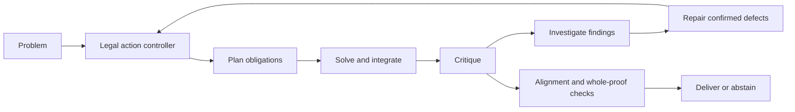

# Usage

This guide describes getting started with the web interface in detail, the
command line and the Python API, stopping and resuming a run, the approaches,
reviewing a proof, evaluating a collection, the settings and the extension
points. Installation, the model services, where your data goes and the known
limitations are in the [README](../README.md).

## Getting started

1. Start the web interface in the folder where your runs should be stored:

   ```powershell
   New-Item -ItemType Directory -Force "$HOME\victorique-work" | Out-Null
   Set-Location "$HOME\victorique-work"
   & "$HOME\victorique-venv\Scripts\victorique.exe" gui
   ```

   It prints the page address, `http://127.0.0.1:8765/` or the next free port
   when another program holds 8765, and opens it in your browser. Keep the
   window open while you use the page; Ctrl+C stops the interface, and runs in
   progress keep going.
2. **Practice run.** On *New problem*, paste
   `Prove that n + 0 = n for every integer n.`, choose the model service
   *Practice run (no model is called)* and press *Start*. The run makes 3 calls
   to a built-in stand-in with fixed example answers and ends with *Proof
   delivered*.
3. **A real run.** Choose *Codex CLI* or *Claude Code CLI* as the model service,
   keep the approach *Solve once and check* and the default limits, paste your
   problem and press *Start*.
4. **Read the result.** The run page shows the status (*Proof delivered*, *No
   proof delivered*, *Stopped by you*, *Failed* or *Stopped before finishing*),
   the delivered proof or the best draft marked as not delivered, each check's
   verdict and findings with their severity, the reason for not delivering, the
   model calls on a timeline, and links to download the run's files.
5. **Stop and resume.** *Stop run* on the run page stops a running run. A run
   whose process ended without finishing, for example after a restart, has a
   *Resume* button. From a terminal, `victorique stop DIR` and
   `victorique resume DIR` do the same for the run folder `DIR`.
6. **Where runs are stored.** In the runs folder: `runs` inside the folder
   where you started `victorique gui` (here `$HOME\victorique-work\runs`), or
   the folder given with `--runs-dir`. Each run has its own folder, such as
   `runs\run-20261119-093000-a1b2c3`, with `proof.md`, `summary.json`,
   `calls.jsonl`, `invocation.json` and the files that `resume` needs. The
   interface keeps the problem text and the command's output in
   `runs\.victorique-gui\NAME\`.

The [web interface guide](gui.md) describes every field and status.

## Command line

The commands below use the environment's `victorique` command:

```powershell
$victorique = "$HOME\victorique-venv\Scripts\victorique.exe"
& $victorique solve problem.md --calls 12 --hours 2 --out runs/my-proof
& $victorique status runs/my-proof
& $victorique stop runs/my-proof
& $victorique resume runs/my-proof
& $victorique export runs/my-proof
```

The environment's Python with `-I -m victorique` works the same way. Without
`-I`, `python -m victorique` started in a folder that contains a `victorique`
folder can load that folder instead of the installed package; the
`victorique` command does not have this problem. Problem files are UTF-8
without a byte-order mark.

Without `--policy` the run uses `single`: one solution, a statement check and a
proof check, delivered only if both checks pass. It makes 3 model calls, plus
one for each call sent again after it reached the per-call time limit (see
[Approaches](#approaches)).

Omit `--model` to use the CLI's configured default, or supply `--model MODEL`.
`VICTORIQUE_CODEX_BINARY` can point to a specific native Codex executable, and
`VICTORIQUE_CLAUDE_BINARY` to a native Claude Code executable. The command
probes public help and version output for the capabilities it needs. It records
the received arguments, freezes the call limit and absolute deadline, then
prints the current action, role and used calls as it runs. `resume` continues
the original requests and limits. It observes uncertain existing requests
before allowing further work. `--transport claude` uses Claude Code CLI for
every role.

Each run produces `proof.md`, `summary.json`, and `calls.jsonl`. The proof includes the selected
candidate and required dependency proofs; check the outcome before using it.
The summary reports the run ID, policy, outcome, claimed role calls, wall
time, reported model and token usage; missing usage fields are `null`. Wall time
runs from initial invocation to the terminal endpoint, including interruptions.
The remaining files in the run directory support resuming the same run.
`calls.jsonl` contains one row per claimed call: run ID, policy, ladder rung when
available, role, reported model and effort, start/end times, status, and CLI token
usage. CLI configuration defaults are recorded separately from a model name
reported by the actual call. Unknown values are `null`. Resume and export
refresh these rows.
The [telemetry guide](telemetry.md) defines cache accounting, model-source
fields and a read-only command for measured throughput and per-role costs.

A practice run from the command line, which needs no model login and produces
synthetic software-test results (this PowerShell command also works in Windows
PowerShell 5.1):

```powershell
[System.IO.File]::WriteAllText((Join-Path (Get-Location).Path 'problem.md'), "Prove that n + 0 = n for every integer n.`n", [System.Text.UTF8Encoding]::new($false))
& $victorique solve problem.md --transport fake --out runs/toy
& $victorique solve problem.md --policy ladder --transport fake --out runs/toy-ladder
```

Python provides the same workflow and returns the summary as a dictionary:

```python
from victorique import solve

result = solve("problem.md", calls=12, hours=2, out="runs/python-proof")
print(result["outcome"])
# The same strategy and check service choices are available from Python:
# solve("problem.md", policy="full", check_transport="claude", out="runs/full-proof")
```

Development uses `pip install -e ".[test]"` and `python -m pytest -q` from the
development checkout.

## Web interface

`victorique gui` serves a page on this computer for starting and following runs
in a browser instead of a terminal:

```powershell
& $victorique gui --runs-dir runs
```

The page opens at `http://127.0.0.1:8765/`; when another program holds port
8765 and no `--port` is given, the interface uses the next free port up to 8785
(or one the system assigns) and prints the address. When the runs folder cannot
be created or written, the command prints one line that names the folder and
the reason and stops with exit status 2; `--runs-dir` chooses another folder.
Paste a problem, choose the approach
(`single`, the preselected default, `ladder` or `full`), the model service and model, the reasoning effort,
the model service, model and reasoning effort of the two checks (Same as the
solver by default; `--check-transport`, `--check-model`,
`--check-reasoning-effort`), the call and time budget, the time limit per model call
(`--call-timeout-seconds`), the retries after a call timeout
(`--timeout-retries`, preselected from the settings file's `timeout_retries`,
else 1), for `ladder` what happens when a check is
undecided (`--undecided-checks`, Abstain or Repair once, preselected from the
settings file's `undecided_checks`, else Abstain), and for every approach
whether a check that passes with minor findings counts as passed
(`--minor-findings`, preselected from the settings file's `minor_findings`, else
Count it as passed), then press Start. The interface runs the ordinary
`victorique solve` command for each
submission, as `python -P -m victorique` in the runs folder, so a folder named
`victorique` in the working directory cannot take the place of the installed
package. It lists every run in the runs folder, shows a run's progress, the
delivered proof or the reason for not delivering one, each check's findings with
their severity, and links to download the run's files. The page of a running
run has a Stop run button, and the page of a run whose process ended without a
summary has a Resume button (see the next section). It listens only on
`127.0.0.1` unless `--allow-remote` is given, and the page loads nothing from
other servers. See the [web interface guide](gui.md).

## Stopping and resuming a run

`victorique stop DIR` asks the run in `DIR` to stop; from Python,
`victorique.stop("runs/my-proof")` does the same and returns what it recorded.
It writes `DIR/stop-request.json` with the time of the request. Asking again
keeps the first request. The run looks for this file before it prepares or
sends each model call and while it waits for one. When it finds the file:

- it sends no new model call;
- a call in flight ends the way a call that reaches its per-call time limit
  ends: the worker process that runs the CLI stops it. The call has the status
  `stopped` in `calls.jsonl` and is not sent again, whatever `timeout_retries`
  says;
- the run ends with the end reason `stopped_by_user` and the outcome `partial`
  and writes `summary.json`, `calls.jsonl` and its best draft in `proof.md`, as
  other endings without a proof do.

In the tests, with offline CLIs on Windows, runs of `single`, `ladder` and
`full` ended 0.4 to 1.3 seconds after the request. A run that can end without
another model call, for example a `ladder` run whose final draft has just
passed both checks, ends as it would have without the request.

`stop` refuses a folder that is not a Victorique run (no `invocation.json`).
For a run whose `summary.json` already has a final outcome it records nothing
and reports `status` `finished`. The request stays in the run folder: when the
run's process has ended without a summary, for example after the computer
restarted, `victorique resume DIR` then ends the run at once without a new
model call. `resume` of a run that has finished, a stopped run included, sends
no call; it says on stderr that the run has finished and returns the summary.
A run whose process ended without a summary and without a stop request resumes
as before: `resume` observes its existing requests and continues within the
original call budget and absolute deadline. `status` and `resume` replay the
whole record, so after a stop they report the same summary as the run itself.

## Approaches

New `solve` and `bench` runs default to `single`. `--policy full` selects the
planning and investigation controller workflow below and is the option for long
problems; `ladder`, `resample` and `bestofn` stay available. Existing runs
retain their original policy, call budget and deadline on resume.
`--policy single` makes three role calls: solve the entire problem, check alignment
with the original problem (the statement check), and review the whole proof (the
proof check). Each check uses a fresh context and the same candidate version.
Both must pass for `complete`: a check passes when it says pass, lists no doubt
and has only minor findings (with the `minor_findings` setting below at
`blocking`, no minor finding either). A failed or uncertain check yields
`abstain`. `single` runs no precheck for unfinished text; `ladder`, `resample`
and the paired runner do. It uses the same transport, role templates, persistent
requests, call budget and absolute deadline. It stops early if a call fails or
the deadline expires.

The default run therefore makes 3 model calls (solution, statement check, proof
check), plus one call for each call sent again after a timeout. In the November
2026 study (GPT-6 Astra through the Codex CLI at the highest reasoning effort,
`ultra`, the CLI's configured default; 288 problem rounds) `single` used on
average 2.91 calls and 44k tokens per round, with a median of 145 seconds per
round; `full` used 8.06 calls and 138k tokens per round.

**Retries after a call timeout.** A model call that ends because it reached the
per-call time limit (`call_timeout_seconds`) is sent again, at most
`timeout_retries` times for that call (default 1, 0–3). Each repetition is a new
call: it counts toward `--calls`, and its time limit is the per-call limit or
the run's remaining time, whichever is shorter. When no repetition is left, no
call remains in the budget or the run's time is up, the run ends at that
timeout as it does with `timeout_retries = 0`: the request stays unknown, and
`resume` observes it again without sending it. Other failures (a refusal, a transport error, an
unusable answer) are not repeated by this setting. Every policy uses it:
`single`, `ladder`, `resample` and `bestofn` send the same request again, and
`full` sends the same work again while its controller still lists it.
`calls.jsonl` gives each repetition a request ID ending in `.timeout-retry-N`
and names the timed-out call in `retry_of`; the timed-out call has status
`timed_out`. `summary.json` reports `timeout_retries_per_call` and
`timeout_retries_used`. Any other unknown transport result stays pending for
observation through `resume`, with no replacement call.

**Check model service.** The statement check and the proof check use the
solver's model service by default. `--check-transport` (codex, claude or
fake), `--check-model` and `--check-reasoning-effort` choose another service,
model or effort for these two checks in every policy, for example Codex CLI for
solving and Claude Code CLI for the checks; planning, solving, repair,
critique, investigation and selection keep the solver's service. An omitted
check model or effort is the solver's when the checks use the solver's
transport, and that CLI's own default otherwise. `fake` goes only with
`--transport fake`. `calls.jsonl` records for each call its `service` (`solver` or
`checks`), `transport`, `requested_model` and reported `model`, and
`summary.json` adds `check_service` (null when the checks use the solver's
service).

```powershell
& $victorique solve problem.md --transport codex --check-transport claude --out runs/cross-check
```

`--policy ladder` begins with a whole-problem solution, deterministic checks for
unfinished text, and two concurrent final reviews. Its reviews pass by the same
rule as in `single`; every policy uses it. Blocking (fatal or material) findings
trigger up to two repair rounds. A repair first assesses each criticism, then changes
the proof only for confirmed defects. The failed review runs first on the next
draft; the other review must also pass on that same version. If the budget runs
out, the result includes the best draft and unresolved issues. If a repair
rejects a precheck finding and leaves the draft unchanged, the run stops,
because the deterministic check would fail the same draft again.
A review is inconclusive when it neither passes nor lists a blocking finding
(outcome unknown, a listed doubt, or a fail with only minor findings), and
incomplete when it returns no valid report after its one retry. By default
either one ends the run with an abstention that names the review; the
`undecided_checks` setting below can instead send the first one to repair.

```powershell
& $victorique solve problem.md --policy ladder --repair-rounds 2 --calls 12 --out runs/ladder
```

`--investigate` enables a separate investigation of repeated disputed findings;
`--escalate` allows the remaining budget to run `full` after the repair rounds.
Both are off by default. These switches apply to ladder. See the
[ladder policy](ladder.md) for retry, version, and budget rules.

`--policy resample` uses the same initial precheck and review trigger as ladder.
After a blocking finding it generates a fresh whole-problem solution without
the previous draft or criticism. It shares the round limit and call budget with
ladder and provides the comparison for testing repair against regeneration.
See [resampling usage](resample.md).

For experiments that continue until the call budget binds, explicitly set
`--repair-rounds 12 --calls 12` for ladder and resample. The default round limit
remains two. The [shared-prefix runner](shared-prefix.md) gives both arms
the same initial candidate and checks before their continuations diverge.

`--policy bestofn` independently generates at least two solutions, selects one
in a pairwise tournament, and applies the same two final checks to the unchanged
winner. It requires `--full-calls PATH` from a paired full run on the same
problem to forecast its token budget. All selection and review costs are
included, and actual overshoot is reported. If a generation call fails, for
example by timing out, generation stops and the solutions already returned go
on to selection and review. See [bestofn usage](bestofn.md).

## How the full workflow works

The `full` policy uses this controller workflow:



The controller enforces call limits, version bindings and explicit feedback
sharing. Both final checks must pass on the same candidate version. The Codex
transport runs each role in a fresh context with a structured response schema,
using the CLI's [non-interactive interface](https://learn.chatgpt.com/docs/non-interactive-mode).

## Review a proof

```powershell
& $victorique verify proof.md --problem problem.md --mode stepwise --passes 1 --calls 3 --out runs/review
```

The command reports `pass`, `fail`, or `incomplete`. It separates mathematical
blocking findings from minor wording findings. `single` uses one review per
pass; `stepwise` asks for step-by-step error checking; `multi` uses three fresh
reviews per pass. A failed model call produces `incomplete`. See
[review and calibration usage](verify.md).

## Evaluate a collection

```powershell
& $victorique bench problems/ --policy single --calls 3 --jobs 2 --out runs/collection
```

Each problem has its own budget and directory. `BENCH.md` and `bench.json` retain
delivery, abstention, failure, timeout and unknown outcomes, with calls, token
usage and elapsed time. Optional reference answers are checked after solving;
the proof grader has a separate interface and cost accounting. Add
`--grader codex` for one separate reference-based grade per delivered proof;
`--grading-seconds S` limits that call (default: the per-call limit below).
See [reference grading and recovery](bench.md), the
[problem files](bench.md#problem-files) and the
[scoring rules](bench.md#scoring-rules).

## Settings

Four settings can be given as command-line options or in a settings file:

| Setting | Option | Default | Effect |
| --- | --- | --- | --- |
| `call_timeout_seconds` | `--call-timeout-seconds` | `600` | Limit for each model call, 0.05–86400 seconds, in `solve`, `verify` and `bench` (also bench grading unless `--grading-seconds` is given). A call also ends at the run's deadline. |
| `timeout_retries` | `--timeout-retries` | `1` | In `solve` and `bench`, how often a call that reached the per-call limit is sent again, 0–3. Each repetition is a new call within `--calls` and the run's deadline; 0 ends the run at the first timeout. |
| `undecided_checks` | `--undecided-checks` | `abstain` | For `ladder` and `resample`: `abstain` stops the run at an inconclusive or incomplete review; `repair` treats the first one like a failed review, with one repair (`ladder`) or one fresh solution (`resample`). |
| `minor_findings` | `--minor-findings` | `nonblocking` | For every policy in `solve` and `bench`, a review that says pass, lists no doubt and lists only minor findings: `nonblocking` counts it as passed; `blocking` counts it as not passed and treats its minor findings like blocking ones, so `ladder` repairs them, `resample` solves again, `full` investigates and repairs them, and `single` and `bestofn` do not deliver. `verify` keeps its own rule. |

A settings file uses TOML:

```toml
call_timeout_seconds = 1200
timeout_retries = 1
undecided_checks = "abstain"
minor_findings = "nonblocking"
```

Pass it with `--config FILE`, or set the `VICTORIQUE_CONFIG` environment
variable to its path to use it for every command. An option on the command line
overrides the file, and the file overrides the default. An unknown key or an
out-of-range value stops the command before it starts a run. The Python
`solve` and `bench` functions take all four names as keyword arguments, and
`verify` takes `call_timeout_seconds`. Each run records the values it used in `invocation.json`; `resume`
keeps them and reads no settings file. A run whose `invocation.json` has
no `timeout_retries` resumes with 0. See the [ladder policy](ladder.md#undecided-checks)
for what a repair receives after an undecided review.

`minor_findings` defaults to `nonblocking`, the 0.1.0b2 rule. A replay judged
one pair of in-loop checks, without repair, on 500 externally written proofs
with human grades (125 correct, 375 wrong). The 0.1.0b2 rule stopped 27 correct
proofs and delivered 23 wrong ones. On the same proofs 0.1.0b1 recorded 42 and
18: it counted a report that said pass and listed findings as invalid. It also
applied the old precheck, which stopped 9 of the proofs (1 correct, 8 wrong);
each of the 9 also failed at least one of the two checks, so the precheck does
not change the 42 and 18. `blocking` reads a report that says pass with
findings the same way as 0.1.0b1, without being identical to 0.1.0b1; the
replay has no separate count for it. Against what 0.1.0b1 recorded, the 0.1.0b2
rule delivered 15 more correct proofs and 5 more wrong ones, whose human scores
are 6, 6, 4, 4 and 4 out of 7. Details are in the
[ladder policy](ladder.md#minor-findings).

## Extension points

The public Python `solve` API takes the same policy, model, budget, deadline,
transport and check service options as the CLI. `victorique.verify.verify` reviews an existing
proof. `victorique.bench.bench` accepts an injected grader, whose response is
validated against the fixed score format. Model transport connects through
`start_once`, `observe_existing`, and `describe`; the shipped Codex, Claude and fake
implementations share the persistent request lifecycle.
